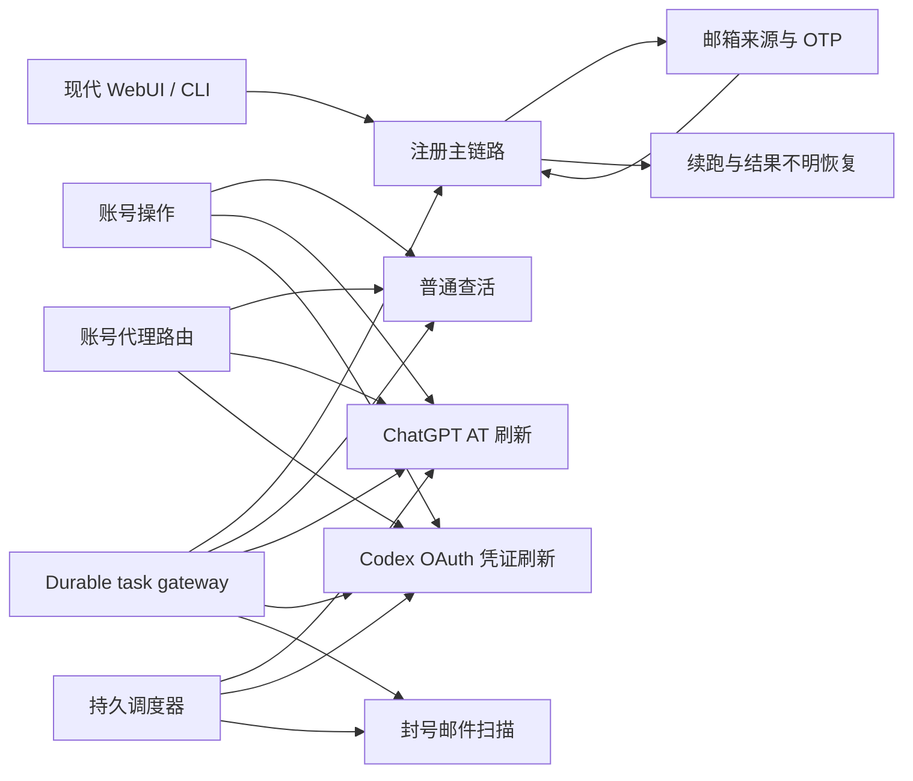

# 功能链路与测试影响地图

这份地图回答两个维护问题：改动一个入口会影响哪些公共组件，应该先跑哪些测试。机器可读的完整数据在 [`functional-map.json`](functional-map.json)，本页只保留便于评审的视图。`tests/test_functional_map.py` 会检查路径、配置键和测试文件是否仍然存在；新增或重命名入口时必须同步更新 JSON。

## 维护规则

每条链路固定记录五类信息：入口、共享组件、可编辑配置、定向测试和验收文档。修改配置 schema 时先在 `config/schema.py` 中确认键，再更新 JSON；修改公共组件时按 `shared_components` 反查所有链路，至少运行这些链路的测试集合。没有改变某条链路行为时，不因为它“相关”就自动执行全量测试。

## 影响范围速查

| 链路 | 主要入口 | 最容易受影响的共享边界 | 首选定向测试 |
|---|---|---|---|
| 注册主链路 | `core/registration_service.py`、`webui/routes/jobs.py` | 状态机、邮箱来源、代理、任务网关 | `test_registration_dispatcher.py`、`test_registration_state_machine_contract.py` |
| 注册续跑 | `core/registration/dispatcher.py` | 邮箱租约、结果不明 reconcile、注册存储 | `test_registration_deactivation_retry.py`、`test_registration_identity_reconciliation.py` |
| 普通查活 | `core/live_check_service.py` | 驱动选择、浏览器灰度、账号代理 | `test_live_check_router.py`、`test_live_check_browser.py` |
| AT 刷新 | `core/token_refresh_service.py` | 持久调度、查活入队、刷新代理 | `test_scheduler_state.py`、`test_account_tasks.py` |
| Codex 凭证刷新 | `core/codex_token_refresh_service.py` | OAuth 凭证、持久任务、调度状态 | `test_codex_token_refresh.py`、`test_codex_token_refresh_durable.py` |
| 封号邮件扫描 | `core/deactivation_mail_service.py` | 邮箱服务、批量任务、调度状态 | `test_deactivation_mail.py`、`test_account_operation_deactivation_policy.py` |
| 邮箱资源与 OTP | `core/email_provider.py` | 邮箱池租约、来源顺序、OTP 轮询 | `test_email_source_selection.py`、对应 provider 测试 |

## 按改动类型选择验证

| 改动类型 | 必跑 | 需要扩大时 |
|---|---|---|
| 单个 UI 控件或文案 | `tests/test_config_ui.py` 或对应页面契约 | 真实浏览器页面和控制台检查恢复后补做 |
| 配置 schema、保存、热加载 | `tests/test_config_schema.py`、`tests/test_config_defaults.py`、`tests/test_config_runtime_contract.py`、`tests/test_config_ui.py` | 涉及 worker/存储时补对应链路测试 |
| 调度器、共享 task gateway | `tests/test_scheduler_state.py` 加受影响链路测试 | 运行时或存储边界变化时使用隔离数据库扩大 |
| 邮箱来源、租约、OTP | `tests/test_email_source_selection.py` 加对应 provider/注册测试 | 邮箱池状态或续跑变化时补注册续跑和存储测试 |
| 账号代理或查活驱动 | `tests/test_account_proxy.py`、`tests/test_live_check_router.py` | 真实浏览器或代理提供商行为改变时单任务验收 |

测试命令、profile 含义和“指定路径的 `all` 不等于项目全量”规则见 [`release-verification.md`](../development/release-verification.md)。
