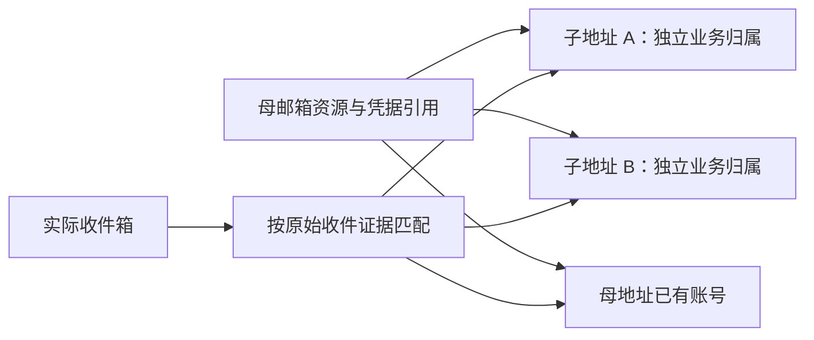

# 通用邮箱子地址与收码隔离设计

日期：2026-10-20。

状态：第一期代码与 30 根真实任务测试已完成；同母多个子号建立独立平台账号的业务验收尚未通过，新生成保持默认关闭。本文保留整体目标；第二节记录改造前的调研，以下实施范围说明优先于后续阶段建议。

本期接入 `icloud_hide` 的本机 `forward_imap` 与持久 Outlook OAuth 母资源，默认关闭生成，每母累计上限 3、后缀 6 位。注册及换绑入队时冻结来源生成策略；当前通过统一配置按来源启用，任务页暂不另设原地址/派生地址覆盖选项。其他 API、付费订单、Butler、直收 Gmail 以及自有域名统一账本属于后续适配范围，不能仅凭支持 `+` 就打开。

认证入口在远端动作前持有完整地址租约；OTP generation 在现有驱动进入取码窗口时推进，候选记录为 `offered`。本期不把“开始等待”写为发码成功，也不伪造各驱动尚未提供的逐次发送/提交回执；远端恢复仍沿用既有 Attempt 与驱动事实。逐驱动的发码前 challenge 钩子属于后续加强项。

新认证租约目前仅保护账本中有持久绑定的子地址，历史普通邮箱沿用原协调流程。母资源的单独策略有仓储接口，本期界面提供全局额度和只读台账；逐母编辑、验证记录管理及显式收件路线迁移尚未开放。原始邮件头解析用于分拣目标邮件，`Received` 的 Apple 主机语法检查不等同于邮件真实性或密码学来源认证。

## 1. 推荐方案

将“邮箱分裂”实现为通用子地址能力，覆盖 `plus_tag` 和已有域名 `catch_all` 等地址生成方式。现有邮箱供应商继续负责资源获取与取信；统一地址层负责完整业务地址、母资源引用、持久归属和收件人匹配。

第一期保留现有邮箱池和 `email_source`，新增子地址账本；母资源策略先放原池记录的 JSONB 扩展字段。收件配置版本与 OTP 请求另外持久化必要事实。避免为每个供应商新增 `icloud_plus`、`outlook_plus` 等来源，也不要求先迁移全部历史邮箱。

核心约束：

- 对目标平台始终使用完整子地址，后续登录、找回、Codex 和换绑都保持同一地址。
- 收信凭据属于母资源或供应商订单，子地址仅引用这些凭据。
- 母地址已经用于注册，不影响其继续生成子地址；可生成资格由资源健康和派生策略决定。
- 每个生成地址绑定一个稳定业务意图，普通失败及结果不明均保留。重跑继续原地址，不需要用户逐项核对。
- 不同子地址必须能准确区分邮件；只有“母邮箱能收到信”不够。
- 某个子地址的业务失败不释放母资源，也不改变其他子地址的状态。

## 2. 已核对的当前边界

| 位置 | 当前行为 | 对设计的影响 |
| --- | --- | --- |
| [邮箱调度层](../../../core/email_provider.py) | 按来源领取、恢复、取码和释放；部分解析依赖进程缓存或完整邮箱查池 | 新增持久绑定优先解析，不能通过删除 `+后缀` 猜归属 |
| [HME 客户端](../../../core/icloud_hme_client.py)与[邮箱存储](../../../core/storage/db_legacy.py) | 同步 Apple 原始别名；从 `available` 领取后记为 `used` | 派生需要独立选择母资源，不能先消费一个原地址再拼后缀 |
| [转发 IMAP](../../../core/forward_imap_client.py) | 搜索四种收件头；解析五种收件头，缺少 `Received` 原始投递证据 | 需区分原始收件人、显示收件人和最终转发目的地 |
| [Outlook 客户端](../../../core/outlook_client.py) | Graph 查询及归一化缺少收件人和原始头；最新 OTP 选择未统一校验完整目标地址 | Outlook 开放分裂前必须先补精确取码 |
| [注册服务](../../../core/registration_service.py) | 已有 root/Attempt；`email_lease_id` 目前是拼出的字符串 | 分配、Attempt 和 job 需在同一事务绑定真实账本引用 |
| [换绑服务](../../../core/email_change_service.py) | 部分付费来源有稳定领取身份；旧邮箱按完整地址回写原池 | 子地址也需稳定领取身份，成功时更新新旧账本而非母资源 |

本次前序投递实验使用一个现有 HME 母地址、两个六位随机后缀及自有 iCloud SMTP 发件账号。三封邮件都进入最终 Gmail：`To` 被改为母地址，完整扩展地址保留在 `Received` 的 `for` 子句；按完整扩展地址搜索 `HEADER Received`，两个后缀各命中一封。

该实验确认了具体链路的可行性。由于发件源是自有 iCloud SMTP，还不能据此承诺真实目标平台发出的邮件一定保留同一证据；上线验收需补目标平台的实际取码。本文不把 `Received` 某处出现邮箱字符串直接等同于可靠归属。

第一轮真实任务补充发现：两封目标平台验证码邮件在 Apple 转发后，完整 child 已不在 `To` 或 `Received for`；最终 Gmail 对原发信签名报失败，而 iCloud 的原始校验记录为通过。`spf.icloud.com` 的同一 `spf=pass` 结果条目保留了原 `smtp.mailfrom`，其中 SendGrid VERP 可完整还原 `local+tag@domain`。因此增加限于该已验证发信域、明确模板及同母 HME 证据的分拣规则，不将一般退信地址当收件人，也不按单独后缀猜测。格式依据可参见 [Twilio 的延迟退信说明](https://help.twilio.com/articles/47454664426395)；具体可用性仍以本链路真实邮件与续跑验收为准。

原任务续跑又收到固定 `tm1.openai.com` 域、`bounce+<6hex>.<6hex>-<完整收件编码>` 格式的新邮件，同样满足 iCloud SPF 通过及 HME 母地址核对。解析仅增加这一实测模板；已知域里明确包含完整子地址但暂不支持的格式，以及未通过 SPF 的同族声明，只用于阻断母地址回退，不用于认领验证码。四封真实邮件回放均只匹配正确子号，母号及兄弟号均不匹配；这项回放不等于完整注册成功。

## 3. 能力按资源与链路声明

“供应商支持加号”与“当前 API 能准确读取子地址邮件”分开记录。建议能力描述为：

```text
generation:       none | plus_tag | catch_all | provider_alias
delivery:         unknown | verified | unsupported
recipient_scope:  exact_address | parent_only | code_only
recovery:         durable | lease_bound | expires | unsupported
evidence:         官方依据、实测时间、资源范围、收件链路版本
```

目标平台是否接受这种地址，另外按 `service/purpose` 记录兼容结果。某个平台拒绝一个后缀不代表邮箱提供商整体不支持。

| 邮箱或来源 | 推荐策略 | 接入条件 |
| --- | --- | --- |
| Gmail / Google Workspace | `plus_tag` | 官方支持；当前取信连接器须返回完整原始收件人。当前项目中的 Gmail 首先是转发目的地，直接作为母邮箱领取属于后续通用 IMAP 来源接入 |
| Outlook.com / Hotmail 消费者邮箱 | `plus_tag` | 补齐 Graph、IMAP 及其他实际取信路径的精确收件人判断后开放 |
| Exchange Online | 按租户验证的 `plus_tag` | 默认启用，但租户能关闭，不能仅凭 `outlook` 来源或域名放行 |
| 普通 iCloud Mail | 按资源验证 | 官方邮箱别名、HME 与 `+tag` 分开；未验证的 `+tag` 保持未知 |
| HME → Gmail | 经验证的 `plus_tag` | 首期落点；确认目标平台邮件的原始收件证据、恢复与母子隔离 |
| 自有域名 catch-all | 原生随机 local-part | 已经能够生成不同地址，继续原生生成；无需强制改成 `+tag` |
| Cloudflare 固定路由 | 按 zone 设置的 `plus_tag` | 开启 subaddressing；Worker 可从 `message.to` 获取完整地址 |
| Cloudflare Worker 临时邮箱 API | 由 adapter 声明 | 邮件路由支持不代表原 mailbox token 可以查询 child，需要验证 API 读取范围与恢复 |
| QQ / 企业邮箱 | 按资源验证 | 不按品牌推定支持；QQ 用作域名邮箱的收件箱与 QQ 地址本身能否派生是两件事 |
| Email Butler | 显式能力协商 | 远端确认母资源可共享、child 精确取码和长期恢复；本机不绕过供应商租约 |
| 通用固定取码 URL | 默认沿用原模式 | 只返回裸验证码时缺少 child 归属依据，不能承诺分裂隔离 |
| GPTMail / CloudMail 等临时来源 | 优先原生发号 | 只有共享读取、子地址归属和寿命均明确时才增加本地派生 |
| Remail / MailCode / 西瓜 / MailNest 等订单或租用来源 | 默认沿用原生领取 | 不根据底层域名自行派生；未来由供应商明确声明订单支持范围 |

官方依据：[Gmail 别名](https://support.google.com/mail/answer/22370?hl=en)、[Workspace 地址变化](https://support.google.com/a/users/answer/9282734?hl=en)、[Outlook.com 发件地址及站点地址](https://support.microsoft.com/en-us/outlook/send-email-from-a-different-address-in-outlook-com)、[Exchange Online 子地址](https://learn.microsoft.com/en-us/exchange/recipients-in-exchange-online/plus-addressing-in-exchange-online)、[Cloudflare 路由和 subaddressing](https://developers.cloudflare.com/email-service/configuration/email-routing-addresses/)、[Apple HME 地址管理](https://support.apple.com/en-ke/guide/icloud/mm1a876f7aed/icloud)。

## 4. 地址、母资源与收件箱的关系

以下对象需要独立表达：

| 对象 | 示例 | 作用 |
| --- | --- | --- |
| 来源 | `icloud_hide` | 现有领取和运维适配器 |
| 母资源 | HME 别名的原池 ID、Apple 账号 ID | 地址生成依据及供应商资源归属 |
| 完整业务地址 | `alias+a1b2c3@icloud.com` | 目标平台注册、账号身份及精确邮件匹配 |
| 收件链路 | HME → 中转邮箱 → 最终 Gmail | 定位实际取信连接器及收件证据规则 |
| 凭据引用 | 原 Outlook 池记录、sidecar 账号、Gmail 配置引用 | 取得取信资格；不是子地址的登录凭据 |



`email_source` 保留原来源。账号、Attempt、job 和换绑记录增加 `email_address_id`；账号的 `email` 继续是完整地址。需要知道来源时先查持久绑定，再走现有历史解析。

已有带 `+` 的邮箱材料保持原样，不能自动去掉后缀建立父子关系。用户明确指定并验证的母资源才允许派生；第一期不递归对子地址再分裂。

## 5. 最小数据模型

### 5.1 子地址账本

新增 PostgreSQL 行级表 `email_address_allocations`，先服务所有新生成地址，不强制搬迁历史原地址。

| 字段 | 含义 |
| --- | --- |
| `id` | 稳定绑定 ID |
| `address` / `address_norm` | 完整地址及查询键；规范化键唯一 |
| `source` | 原邮箱来源 |
| `parent_kind` / `parent_id` | 类型明确的稳定母资源引用；不以字符串前缀猜测 |
| `parent_address` | 地址快照，仅用于解释与核对，不替代真实引用 |
| `inbox_profile_id` | 固定的收件配置版本引用 |
| `strategy` / `tag` | 生成策略及后缀 |
| `acquisition_id` | 稳定领取身份，唯一 |
| `owner_kind` / `owner_id` | 注册 root、CLI 持久意图或换绑意图 |
| `state` | `reserved` / `used` / `replaced` / `retired` |
| `account_id` | 成功后的业务账号引用 |
| `created_at` / `updated_at` | 审计时间 |
| `data` | 路由版本、能力证据、策略版本、结果不明标记等非密钥扩展 |

提升用于唯一性、筛选和原子抢占的列，其余进入 JSONB。母资源策略先保存在原池记录的 `data.derivation_policy`；若配额或查询成为热点，再提升字段和索引，不额外复制全套邮箱平台。

普通绑定不保存 Cookie、邮箱密码、Token、验证码、邮件原文或完整取码 URL。凭据留在现有受保护的母资源/订单位置。启用派生后，母记录被普通列表“删除”应转为归档并停止新分配，保留历史账号引用，不能物理删除其唯一恢复资料。

子地址只写新账本，不写回 `email_pool_icloud_hide` 的 Apple 远端库存，也不调用 Apple 创建别名。远端同步继续只处理真实母别名，保留本地派生策略；不能将子地址当作 `remote_missing` 清理。

### 5.2 母资源状态

母地址的 `used/replaced` 是业务使用状态，不能作为“收件资源已失效”的判断。派生选择同时检查：

1. 明确开启派生，策略和当前连接器匹配；
2. 上游资源仍有效，凭据和收件链路可用；
3. 配额尚有余量；
4. 没有人工停用整个资源；
5. 当前收件链路具备精确地址归属和所需恢复能力。

旧 `failed/disabled` 记录不能自动重新启用，先区分业务失败、人工停用与资源故障。对经确认可收件的 `used/replaced` 母资源，可以独立开启派生，不把原地址重新改成 `available`。

### 5.3 收件配置的持久版本

新增共享表 `email_inbox_profiles`，保存实际收件身份及配置版本，包含 `id`、稳定 `inbox_key`、`revision`、连接器类型、收件定位信息、`credential_ref`、证据规则版本和生命周期。多个 HME 母资源可引用同一份最终 Gmail 配置，不按子地址复制凭据。

这里的 `credential_ref` 不能只是会被覆盖的当前 `ICLOUD_HME_FORWARD_IMAP_PASSWORD` 配置名。新收件配置的应用密码仍只写 `.env`，使用独立、持久的 profile 对应密钥引用；既有 Outlook 和订单凭据沿用其原受保护存储。路由表不保存新的应用密码副本。

切换 Gmail 账号时，先保存旧收件身份需要的版本化密钥引用，再准备并验证新 profile，最后切换新分配的默认引用。失败保留旧配置；被历史绑定引用的 profile 和密钥不能随新配置保存被清除。仅同一实际收件身份的凭据轮换可更新原凭据引用内容，不能借此切换收件账号。

已有绑定固定引用原 profile，不因全局配置修改而改读另一个邮箱。如果上游实际转发链也迁移了，应验证新链路后显式关联新路由版本，保留变更历史；地址和业务归属保持不变。迁移期间的候选和 cursor 不跨版本混用。

第一期共新增三个聚焦的行级事实：地址分配、收件配置版本、OTP 请求。不重建现有供应商凭据和订单体系。

### 5.4 生成与唯一性

推荐默认 `+` 后接六位随机小写字母数字，长度可配置。生成前验证本地部分和完整地址长度，不截断母地址。沿用现有地址大小写兼容规则；保留 `+`、点和后缀，不做跨供应商的点号等价或去标签归一化。

每次领取使用一个短事务：

1. 按稳定 `acquisition_id` 获取事务锁；已有分配直接返回。
2. 原子选择并锁定合格母资源，检查累计派生额度。
3. 生成地址；在同一地址业务锁下检查账本、已注册账号和原有邮箱池，含归档及废号记录。
4. 唯一插入 `reserved` 绑定；仅本地随机碰撞时重新生成，建议最多五次。
5. 同事务写回原 Attempt、job 的真实地址绑定，并保留批次完整邮箱领取记录。
6. 提交后才向注册驱动返回完整邮箱字符串。

仓储接口需要显式传递同一连接，不能在外层事务里调用自行提交的旧接口后声称原子绑定。母资源锁、地址锁的顺序必须在领取、导入、账号写回中保持一致。

注册的领取身份绑定 root，而不是某一次 Run。换绑绑定当前换绑意图；同一意图的重试不产生新地址。导入、直接领取和账号写入也检查账本，避免同一子地址随后作为普通材料再次分配。

同一批次可以多次使用同一母资源，但不能重复分配同一个完整地址。现有 `registration_batch_email_claims` 继续记录完整地址，不按母地址去重。

## 6. 生命周期与重跑

| 事件 | 子地址处理 | 母资源处理 |
| --- | --- | --- |
| 新意图领取 | 创建 `reserved`，绑定原 root/Attempt | 不改变母地址业务状态 |
| 普通失败、超时、重启中断 | 保留原分配；原任务可重跑 | 保留 |
| 远端提交结果不明 | 保留原地址、密码、Attempt 和事实标记；沿用现有原身份续跑 | 不释放或重购 |
| 注册成功并保存账号 | 同事务更新账号引用与 `used` | 保留 |
| 换绑成功 | 新地址 `used`，旧绑定 `replaced`，同事务更新账号 | 不因旧子地址被替换而停用母资源 |
| 用户明确放弃或完整地址永久不可用 | `retired`，停止新任务分配 | 仅在确认母资源故障时调整其健康状态 |
| 暂停派生功能 | 停止新生成；旧绑定仍能取码和续跑 | 保留凭据和路由 |

派生地址成本低，建议不跨业务意图回收复用。第一期无需为子地址增加 `available` 池；普通失败继续属于原任务，避免低价地址复用带来的远端重复注册风险。

执行租约与地址归属分开：Run 的心跳过期只能结束旧执行资格，不能把地址送给另一任务。启动恢复收口中断 Run，原 root/Attempt 重新取得执行 fence 后继续使用原绑定。

不能新增“结果不明就必须人工审核”的普遍门槛。已有原身份、原密码等资料满足当前重跑条件时继续自动续跑；只有确实缺少恢复资料、已有活跃执行等现有条件才返回具体原因。

## 7. 统一取信与收件人匹配

### 7.1 通用契约

保留 `acquire_email(...) -> str`、`wait_for_otp(email, ...) -> str` 供现有驱动调用，内部引入：

```text
AddressBinding:
    id, exact_address, source, parent_ref, acquisition_id, state

MailRoute:
    exact_target, parent_ref, credential_ref, inbox_locator,
    recipient_evidence_profile, route_revision

MailCandidate:
    stable_message_key, delivered_at, original_recipients,
    displayed_recipients, forwarding_destinations, recipient_evidence,
    sender, subject, body

resolve_route(binding_id | exact_address)
    -> adapter.fetch_candidates(route, cursor, since)
    -> recipient_match(route, candidate)
    -> select_otp(challenge, candidate)
```

邮件正文仅在现有私有取信路径内短暂用于提码，不进入普通任务、事件和账号列表。共享 matcher 同时用于 OTP 和封号邮件扫描。

### 7.2 原始收件人证据

- 直收链路优先使用连接器明确交付的信封目标、API 原始收件人；完整 `To/CC` 是否可作为依据取决于链路是否改写。
- HME 转发链按已验证的证据规则解析 `Received` 的 `for <完整地址>`。搜索 `HEADER Received` 仅负责召回候选，不能直接决定归属。
- 已验证的 iCloud/OpenAI SendGrid 链路，可解析 `spf.icloud.com` 同一 SPF 通过条目中的完整 VERP 原收件人。限定发信域和模板，并与 `X-ICLOUD-HME` 同母信息核对；冲突时拒绝。`Return-Path` 或 `Authentication-Results` 的编码地址搜索同样只召回候选。
- 本链路的 `X-ICLOUD-HME` 是参数头，只使用明确的 `p` 母地址；`f` 转发目的地和 `s` 发件人不参与母资源判断。多值或冲突证据不降级猜测。
- 不把 `Received` 内的发件人、任意邮箱字符串或声称来自 Apple 的主机名一概认作原始目标。规则要定位实际转发链生成的证据，处理折叠、重复和冲突头。
- 其他最终 `Delivered-To` 或 `X-Forwarded-To` 可能只是收件 Gmail，不能据此将所有邮件分给某个子地址。
- IMAP 搜索可能采用子串匹配，取回后统一解析完整 addr-spec，再做精确比较。
- 查询保留日期、数量和共同截止时间限制；不为每个子地址下载整个母收件箱。

**母地址账号也必须接入同一判断。** 当原始收件证据证明邮件投给 child 时，即使 `To` 已被改写为母地址，也不能将这封邮件返回给母账号。

对于存在改写的链路，若原始证据缺失或冲突，继续等待其他候选；超时返回具体、可重跑的收件原因。不能回退到母收件箱最新验证码。即便把 sibling 串行执行，迟到旧信仍可能混入，串行不能替代精确收件归属。

### 7.3 不同连接器

- 本机 HME/Gmail：增加有界 `Received` 搜索及证据解析，同时调整母地址判断。
- Outlook：Graph 增加 `toRecipients`、必要原始邮件头，归一化保留证据；所有实际取信分支共用 matcher。[Graph 官方消息模型](https://learn.microsoft.com/en-us/graph/api/resources/message?view=graph-rest-1.0)支持这些字段，原始头需显式选择。
- QQ/域名和 HME 直读：替换字符串包含判断，使用结构化的完整地址匹配。
- Cloudflare Worker：优先使用实际入站 `message.to`，并验证 API 的 mailbox 权限范围。
- Butler：先扩展远端契约，返回 `matched_address`、稳定消息 ID、投递时间和证据类型；只返回裸 `code` 的旧接口不声明精确子地址能力。本机与 Oracle 模式分别验收。

## 8. 发码、OTP 与并发协调

不同子地址可以并发。同一个完整地址的注册、密码找回、MFA、Codex 等发码，共用跨进程的认证租约，防止两个流程互相覆盖验证码。

租约必须在可能触发发码的远端请求之前取得；仅在 `wait_for_otp()` 入口加锁太晚。自动发码的邮箱提交也属于这个边界。

建议新增小型 `email_otp_requests` 协调表，至少保存：

```text
address_binding_id 或历史完整地址键
owner_kind / owner_id / attempt_id
challenge_id / send_generation
requested_at / send_state / cursor
candidate_message_key / submission_state
当前执行 token、fence、期限与时间戳
```

只有同一未终结远端认证会话内、没有触发新发码的重复取信，才复用原 challenge。显式重发、重建远端登录会话或再次提交邮箱触发自动发码，都在远端动作前推进 `send_generation`，记录新的会话引用和时间窗口，不能因属于同一 Attempt 就沿用旧 challenge。

远端确认成功、明确失效、取消、过期或新会话替代时，终结相应请求并释放其认证执行租约；保留已有提交事实，不把未知提交改写为成功。租约过期后原任务可自动取得新 fence，按当前会话继续或建立新 generation，不能留下永久占用。执行 fence 失效后，旧 worker 不能更新新执行的候选或提交结果。

候选 ID 使用 `inbox + UIDVALIDITY + UID` 或 API 稳定消息 ID；跨连接器回退要确认是否能映射同一消息，不能只比较六位验证码。两封邮件包含同样数字仍是不同消息。

“取到候选”“开始提交”“远端确认成功”分别记录。取到码不立即永久消费；同 Attempt 重启后可以重新读取仍有效的原候选。远端结果不明沿用现有恢复事实，原任务仍能以原身份继续认证，不因候选曾被读取而永久阻断。

时间优先使用实际投递时间，IMAP 使用 `INTERNALDATE`；UID 基线用于缩小候选范围。cursor 按 `inbox_key + UIDVALIDITY + route_revision` 隔离；UIDVALIDITY 或路由版本变化时废弃旧 UID 基线，在原时间窗口内有界重扫，不能继续使用旧高 UID 导致永久漏信。

跨 Graph、IMAP 或 Butler 回退时，若无法映射同一消息，应清楚保留“消息映射未知”，重新按当前 challenge 的时间、地址证据和执行 fence 选择候选，不能按相同验证码数字宣告已消费。所有回退仍须满足精确收件人判断，不能进入旧版母箱最新码路径。

这些措施不能绝对证明迟到邮件属于哪次远端 challenge，仍须保留无效码后的正常重发流程。持久协调记录不存裸验证码或正文，现有付费供应商私有游标语义单独保留。

如果不同子地址最终落到同一个 Gmail，连接预算按实际收件箱管理，不把“子地址数量”当成网络连接容量。第一期沿用有界 I/O 预算和现有批量扫描协调，不新增常驻收件 worker。

## 9. 全链路接入与配置体验

| 场景 | 必须保存或调整 |
| --- | --- |
| 注册的全部驱动与 CLI | 完整邮箱、原来源、地址绑定、冻结的生成方式；驱动继续接收字符串 |
| 原任务重跑 | root/Attempt 对应同一领取身份；不根据当前配置重生成 |
| 成功账号写回 | `email_address_id` 与账号 `email/email_source` 同事务保存 |
| 换绑 | 稳定目标领取意图；原账号快照及新旧绑定同事务收口 |
| AT 刷新、密码、2FA、Codex | 持久绑定解析母凭据，完整子地址进行认证与收件匹配 |
| 查封号邮件 | 使用同一原始收件人 matcher，不把母邮箱内一封通知分给全部 child |
| 素材及凭据恢复 | 区分业务地址和邮箱登录名，引用真实母资源，不把 child 当作 IMAP 登录账号 |
| 删除、归档与禁用 | 默认停止新生成，保留已有绑定恢复依据；不得级联删除 |

注册页保留原来源下拉框，增加“原地址 / 派生地址”选择；来源和生成方式均冻结到任务快照。显式选择派生后，失败不能静默换成母地址、其他策略或其他供应商。

邮箱池提供母资源列表与“查看子地址”入口，区分母资源健康、原地址已使用、子地址已分配/已注册/已换出、派生额度及最近收件验证。界面展示具体原因，不展示内部凭据、原始邮件头或 OTP 协调字段。

建议首期默认值：

- 全局派生关闭，由用户按来源/母资源启用；关闭只影响新生成。
- 后缀六位；每母资源累计派生上限先设为 3，可调整。这是运营额度，包含已生成历史，不声称是提供商限制。
- 按需生成，不预先创建海量子地址。母资源按已分配数量和健康状态分散选择，避免一批全部落在一个母资源上。
- 同一完整地址只允许一个活跃发码流程；不同子地址可并发，实际连接继续遵守收件箱预算。
- 独立配置“停止新派生”和“停用整个收件资源”，避免一个开关让历史账号无法找回。

供应商能力预设和纯配置放 `config/`；单个母资源的启用、额度、健康和实测证据放 PostgreSQL。实现可编辑配置时同步 schema、配置模块、`.env.example`、当前 WebUI 和 README。

## 10. 实施顺序与发布

### 第一阶段：公共模型与历史兼容

实现账本、能力契约、完整地址解析、结构化收件证据和 OTP 协调基础；全部受开关控制。保持原地址历史解析入口，清理会造成误配的字符串包含判断。

### 第二阶段：HME/Gmail 完整闭环

接通母资源选择、幂等领取、注册各驱动、重跑、账号保存、换绑、密码/MFA/Codex、封号扫描和软归档。完成母地址与两个子地址并存的隔离测试后，补目标平台小范围真实取码验收，再开启批量派生。

先验收本机 `forward_imap`。使用 Oracle `forward_butler` 的环境需先完成远端证据响应和独立验收，不能因为本机成功就直接宣布两种链路可用。

### 第三阶段：Outlook 与其他持久来源

补齐 Outlook 实际连接器、邮箱类型识别和恢复；逐个资源启用。自有域名延续已有随机地址方式，并接入统一身份/收件匹配。若需要将 Gmail 直接作为领取来源，再增加通用 IMAP adapter，无需把品牌写进子地址核心逻辑。

### 第四阶段：远端 API 与订单来源

按供应商声明接入共享取码、寿命和恢复能力；保留现有付费幂等订单和租约收口，不把本地后缀生成变成远端重复购买。

实现涉及存储时使用独立 worktree 与隔离 PostgreSQL schema；当前工作区已有修改，应原样保留。迁移幂等、只增加数据结构，默认不修改历史带 `+` 的账号，也不创建实际子地址。

关闭新生成即可停止扩展，但回滚版本仍必须保留子地址读取和恢复能力。已经用子地址建立的账号不能靠回退旧代码恢复；不得在回滚时删除账本或新表。

## 11. 验证与验收标准

至少覆盖以下场景：

1. 一个母资源的母地址账号、两个 child 同时存在，邮件只归属正确地址。
2. `To` 改写、重复/折叠/冲突 `Received`、显示名伪邮箱及 IMAP 子串召回均不导致混码。
3. Outlook、Gmail、QQ/域名与 Butler 分别验证实际连接器，缺少证据时不伪造成功。
4. 多进程领取同一 `acquisition_id` 只生成一个地址；不同意图碰撞时由数据库唯一性处理。
5. 分配事务中断、领取后崩溃、远端提交结果不明、服务重启均继续原 root/Attempt 和地址。
6. 母地址已 `used/replaced` 时能按明确策略派生；单个 child 失败不释放母资源。
7. 换绑的新旧地址状态、账号邮箱和绑定引用在同一事务更新。
8. 同一地址两条认证流程在发码前协调；不同 child 允许并发；旧 fence 无法覆盖新执行。
9. 同一数字的不同消息、UIDVALIDITY 改变后 UID 变小、Graph→IMAP 回退、无收件证据的回退、晚到旧信和候选领取后重启均符合 OTP 生命周期；重建远端会话推进 generation，过期租约不永久阻断重跑。
10. 母池归档、关闭派生、凭据轮换后，已有账号仍可按原引用恢复；更换收件 Gmail 不静默改变旧绑定的收件身份，真正资源故障给出准确原因。
11. 新生成与普通导入、历史账号及批次去重并发冲突时，不产生第二份地址所有权。
12. 普通 API、日志、任务事件和导出不泄露邮箱凭据、验证码或原始邮件正文。

真实验收分开报告：邮件投递成功、目标平台接受地址、目标平台验证码正确归属、注册/登录成功、重启后恢复成功。

2026-10-20 已执行 30 根真实注册任务，按根任务去重后为 9 成功、21 失败；原链续跑不计成新账号。共分配 30 个不同子地址、30 个不同 Attempt，10 个母资源各累计 3 个，后缀均为 6 位。完整地址、Attempt 分配 ID、账本及已有账号的公开关联检查均一致，全历史母资源额度未超限。9 个成功账号的远端用户和账号标识均不同，Token 邮箱与完整子地址一致，Token、已保存密码、TOTP 和套餐检查齐全；密码状态仍为 `started`，不据此声称所有账号都通过了独立密码登录验证。

四封真实目标邮件的原始头与实际适配器回放均只匹配正确子号，不匹配母号或兄弟号。9 个账号已通过实际取码和注册，但这 9 个成功账号来自 9 个不同母资源，尚不能据此宣布每母 3 个都能建立独立平台账号。至少两例失败已确认是 OTP 通过后 `create_account` 返回 HTTP 400；当时没有响应正文，原因未知，不能断言为邮箱归一化或重复账号。对其中一个原任务追加两次串行调试续跑，分别停在密码表单未就绪及代理隧道连接失败，没有取得第二个独立身份的新证据。

因此实测后已恢复 `EMAIL_DERIVATION_ENABLED=False`，保留每母上限 3、后缀 6 位及全部既有绑定。关闭新生成不阻止已有子号沿原 root/Attempt 恢复；失败和结果不明的分配均保留，未重新投入池中。真实验收材料仅记录 ID、状态、哈希和布尔结果，不保存邮箱明文、验证码或 Token。未取得 Outlook 实测素材，不把本机 HME/Gmail 结果外推到其他连接器。

## 12. 设计取舍

选择通用子地址账本加现有母资源策略，而非逐个客户端拼后缀：能够统一恢复、换绑和收码，同时控制改造范围。

第一期保留现有邮箱池与供应商订单，避免一次性替换所有来源。以后需要更统一的邮箱资源表时，可依据稳定 `parent_ref` 迁移，不改变已经分配的业务地址。

优先交付 HME/Gmail 的完整业务闭环，再开放 Outlook 等来源。通用能力从一开始定义，具体提供商按证据接入；“多数邮箱可能支持”用于扩展方向，不作为默认精确取码承诺。

相关项目约束见[存储架构](../../architecture/storage-architecture.md)、[当前架构](../../architecture/current-architecture.md)和[README](../../../README.md)。
